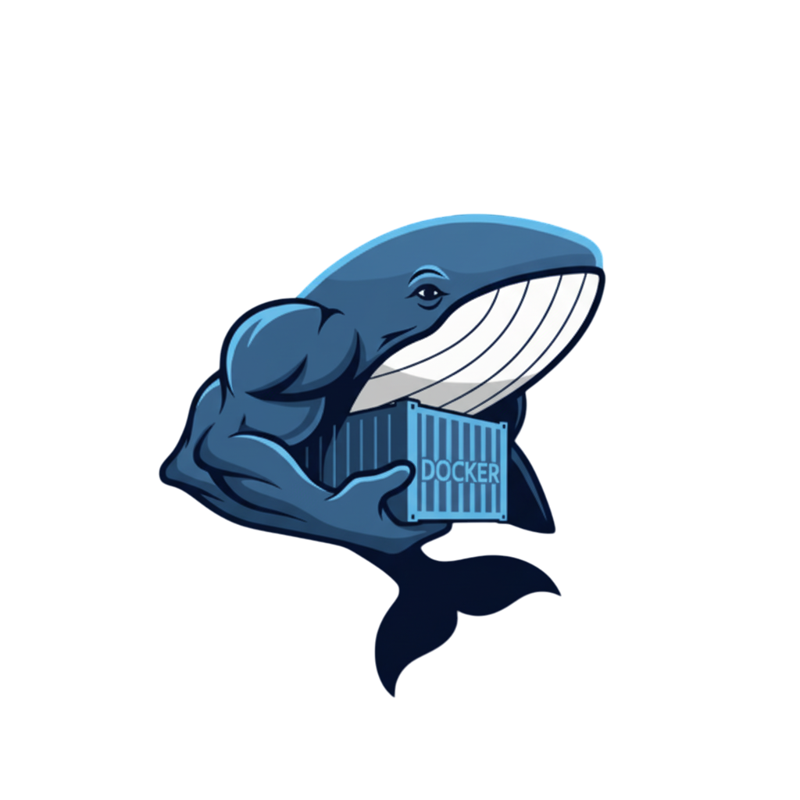
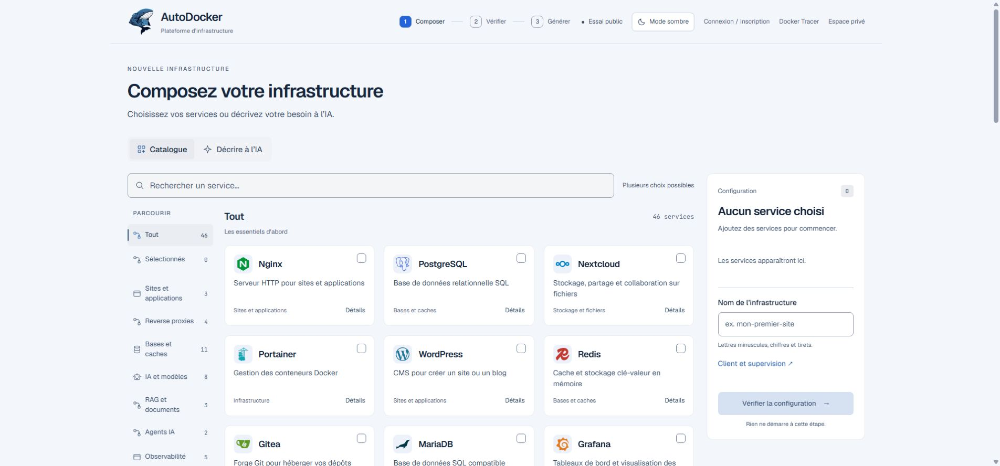
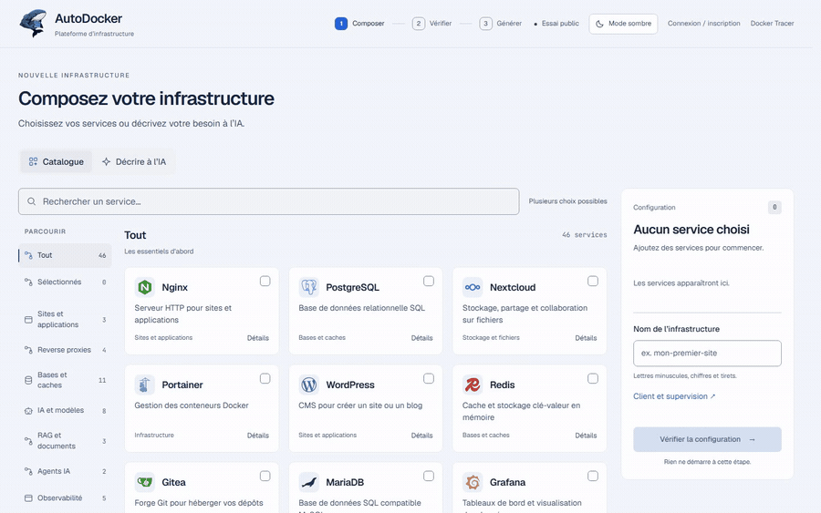

# AutoDocker

**Créer une infrastructure Docker, du besoin au fichier Compose.**

Choisissez vos services ou décrivez votre idée à l’IA, vérifiez la configuration et exportez votre infrastructure.

Version **0.1.0-beta.7** · [Toutes les versions](https://github.com/caroneloham/autodocker/releases) · [Documentation](#documentation)

## Ce que vous pouvez faire

| Composer | Utiliser votre IA | Vérifier | Exporter |
| :--- | :--- | :--- | :--- |
| Sélectionner les services dans le catalogue et régler leur configuration. | Brancher Ollama, LM Studio, vLLM ou une API depuis l’interface locale. | Relire la configuration et visualiser les services et leurs connexions. | Récupérer les fichiers de l’infrastructure pour préparer son déploiement. |

La génération manuelle fonctionne sans IA et sans moteur Docker. L’application locale peut se connecter à Docker ou Docker Desktop depuis **Mon compte**.

<strong>Voir une courte démonstration</strong>

## Démarrer

### Dans le navigateur

Ouvrez [autodocker.eu/essai](https://autodocker.eu/essai/), composez votre infrastructure et exportez vos fichiers. L’IA de l’essai est soumise à un quota : deux demandes par jour sans compte, puis cinq avec un compte. Les [limites détaillées](docs/Essai-public.md) sont documentées.

L’essai permet de générer, exporter et visualiser un Compose. La gestion d’un hôte Docker est disponible dans l’application locale.

### Sur votre ordinateur

| Windows x64 | Linux x64 |
| :--- | :--- |
| [Télécharger le ZIP](https://github.com/caroneloham/autodocker/releases/download/v0.1.0-beta.7/AutoDocker-Windows-x64-preview.zip), puis l’extraire entièrement. | [Télécharger l’archive](https://github.com/caroneloham/autodocker/releases/download/v0.1.0-beta.7/AutoDocker-Linux-x64-preview.tar.gz), puis l’extraire entièrement. |
| Double-cliquer sur **Lancer AutoDocker.cmd**. | Ouvrir un terminal dans le dossier et lancer `./lancer-autodocker.sh`. |

Le navigateur s’ouvre pour créer votre compte propriétaire. Dans **Mon compte**, vous pouvez ensuite connecter Docker et choisir votre IA. Les comptes, projets et réglages restent dans le dossier extrait : conservez-le pour garder vos données.

## Deux projets complémentaires

**AutoDocker** aide à créer l’infrastructure initiale. **[Docker Tracer](https://github.com/caroneloham/docker-tracer)** permet d’explorer un Compose sur une carte, d’éditer sa configuration et, en local, de travailler sur une installation Docker existante.

## Documentation

- [Dépannage : erreurs courantes et solutions](docs/Depannage.md).

- [Wiki : installation et utilisation](https://github.com/caroneloham/autodocker/wiki).

- [Développer depuis les sources](docs/Developper.md) : prérequis Go, tests et lancement local.
- [Construire et héberger l’essai public](docs/Essai-public.md) : Docker Tracer, configuration et quotas.
- [Contribuer](CONTRIBUTING.md) · [Signaler une vulnérabilité](SECURITY.md) · [Logos et marques](docs/attributions/Logos-et-marques.txt).

## État du projet et licence

AutoDocker est en **bêta**. Relisez les fichiers générés avant un déploiement réel. La configuration d’une IA et les fonctions Docker dépendent des services que vous connectez. Le serveur local reste sur `127.0.0.1` et ne doit pas être exposé directement sur Internet.

Le code est accessible sous la [licence AutoDocker et Docker Tracer 1.0](LICENSE). L’usage en entreprise, les modifications et la vente des infrastructures produites sont permis selon ses conditions. La vente du logiciel ou d’un accès SaaS payant est interdite. Cette licence n’est pas une licence open source approuvée par l’OSI. Les composants tiers conservent leurs propres conditions.

## Remerciements

Merci à [IngéPLUS](https://inge-plus.fr/avr-2026-bourses-ia-bac3-ingeplus-accompagne-les-talents-de-bts-vers-les-metiers-de-lia/) pour son soutien financier à travers la bourse qui m’avait été accordée à l’époque.
